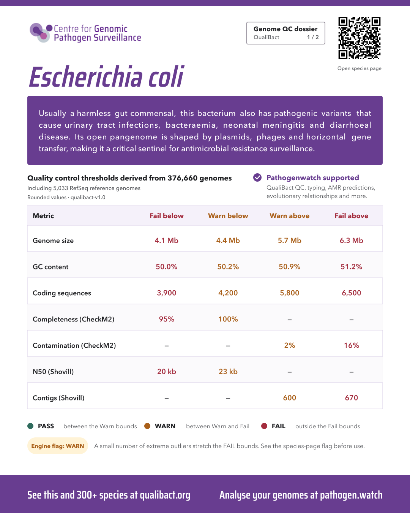

# QualiBact genome QC dossiers

This repository generates the two-page, 1080 × 1350 px CGPS/QualiBact species dossiers used as LinkedIn carousel images. Page 1 contains the species overview and QualiBact's **published rounded** WARN/FAIL thresholds; page 2 contains the methods note and three source figures. The design is fixed: source values and curated species summaries change, but type sizes and plot frames do not.



The [`examples/`](examples/) folder includes both pages for *Escherichia coli*, *Klebsiella pneumoniae*, and *Campylobacter coli*. Generated output is not committed beyond these examples.

## Requirements

- macOS with Python 3.11 or newer, [`uv`](https://docs.astral.sh/uv/), and `rsvg-convert` (`brew install uv librsvg`). The bundled Saira Condensed SemiBold font is used for display type. Avenir Next, supplied with macOS, is used for body type and for exact line measurement. The bundled Saira font retains its [Open Font License](fonts/OFL.txt).
- Network access to `qualibact.org` and `static.qualibact.org` for the initial download or a refresh. Once the cache is populated, rendering can run offline.
- Roughly 30 MB of local space for the downloaded inputs and 26 two-page renders.

On another operating system, set `QCD_BODY_FONT` to an installed font file and `QCD_BODY_FAMILY` to that font's SVG family name. Different font metrics may change line breaks; preflight deliberately fails rather than shrinking text. For exact reproduction of the examples, use macOS Avenir Next. `QCD_SAIRA_FONT` can override the bundled display font.

## Rebuild all current dossiers

From the repository root:

```sh
uv run --script download_qualibact_data.py --all --refresh
QCD_OFFLINE=1 uv run --script build_qualibact_dossier.py --all --preflight
QCD_OFFLINE=1 uv run --script build_qualibact_dossier.py --all
QCD_OFFLINE=1 uv run --with pillow --with fonttools --with 'qrcode[pil]' python -m unittest discover -s tests -v
```

`--refresh` fetches the QualiBact species index, every mapped species page, the preferred-scheme manifest, and the three figures used on page 2. It saves the raw inputs under `cache/qualibact/` and a structured, checksum-labelled record of URLs, counts, source overview text, published threshold tables, engine flags, and figure paths in [`data/qualibact-snapshot.json`](data/qualibact-snapshot.json). The cache is deliberately git-ignored: rerun the first command to recreate it. The snapshot committed here records the source data used for the example run; a refresh replaces it locally, so review its diff before committing a new version.

Preflight checks source completeness, scheme, text fit, table values and figure availability without rendering. The final command writes two PNGs, two editable SVGs, provenance JSON and alt text for each species under `output/qualibact-dossiers/<Genus_species>/`. It also writes `coverage.json` and a failure report in that output folder. A batch with any failure exits non-zero.

To rebuild one species after downloading its inputs:

```sh
QCD_OFFLINE=1 uv run --script build_qualibact_dossier.py 'Escherichia coli'
```

To download one species afresh, use `uv run --script download_qualibact_data.py 'Escherichia coli' --refresh` first. `QCD_OFFLINE=1` makes missing cached inputs an error instead of silently accessing the network.

## Editorial and eligibility rules

- [`dossier_summaries.json`](dossier_summaries.json) contains the individually edited, source-grounded copy. It is **never generated or rewritten** by the downloader. The approved *E. coli* summary defines the maximum length, and every summary must fit the fixed panel. If QualiBact's overview changes materially, edit the relevant JSON entry and run preflight again.
- The fixed scope starts with the Pathogenwatch supported-organisms list reviewed on 27 September 2026, then cross-checks QualiBact's species index. It uses one *Salmonella enterica* dossier, maps the *Enterobacter cloacae* complex entry to *E. cloacae*, and excludes *Shigella*, viruses, and fungi. The list is intentionally explicit in [`build_qualibact_dossier.py`](build_qualibact_dossier.py); review it when Pathogenwatch's supported list changes.
- A species whose preferred-scheme QualiBact page has an **ERROR** engine flag is excluded before any dossier can be rendered, including a direct single-species request. The current six exclusions are recorded in the source snapshot and `coverage.json`. WARN appears in amber, INFO in pale purple, and no flag means no chip or explanatory line. An unrecognised flag fails closed for review.
- Table numbers are taken from the **published rounded** table on each species page, not recomputed from raw thresholds. Figures are downloaded from the manifest's source paths. Source URLs and selected figure URLs are retained in each dossier's provenance file and encoded in its QR code.
- This creates reviewable artwork; it does not publish or schedule LinkedIn posts. Inspect the rendered pages before external release, especially after a QualiBact refresh.

## Files

| File | Purpose |
| --- | --- |
| [`download_qualibact_data.py`](download_qualibact_data.py) | Fetch source pages, manifests and figure images; save the structured snapshot. |
| [`build_qualibact_dossier.py`](build_qualibact_dossier.py) | Select eligible species, validate copy and source values, render dossiers. |
| [`make_qualibact_dossier_mockups.py`](make_qualibact_dossier_mockups.py) | Approved SVG layout and typography. The historical filename is retained to avoid changing the renderer's import. |
| [`dossier_svg.py`](dossier_svg.py) | Small standalone SVG helpers; no dependency on the earlier CGPS poster project. |
| [`dossier_summaries.json`](dossier_summaries.json) | Curated descriptions, including retained drafts for ERROR-excluded species. |
| [`data/qualibact-snapshot.json`](data/qualibact-snapshot.json) | Auditable source-data snapshot with URLs and SHA-256 checksums. |
| [`tests/`](tests/) | Source, exclusion, checksum and example-image regression checks. |

QualiBact source: <https://qualibact.org/species/>. Pathogenwatch eligibility list: <https://pathogen.watch/supported-organisms>. The CGPS logo remains a CGPS brand asset, not a generic icon.
